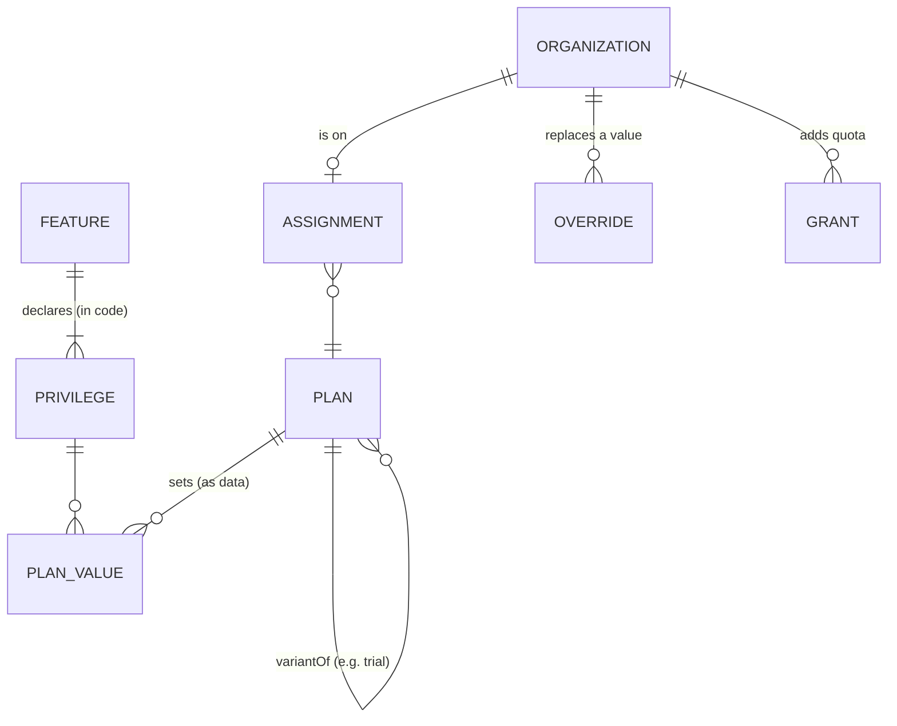

# 1. Data model

## Overview

The model has two halves. Keep them apart:

- **Definitions live in code.** Features and privileges are declared by the application, because a privilege only means something where code enforces it. A privilege nobody checks is dead data, and a check against an undeclared privilege is a bug.
- **Values are data.** What a plan gives, and every per-customer exception, lives in the provider. It is editable at runtime and audited, and MUST NOT require a deploy to change.

### 1.1. Features and privileges (the catalog)

#### Requirement 1.1.1

> A **feature** MUST have a `code` and a `name`, MAY have a `description`, and MUST declare one or more **privileges**.

#### Requirement 1.1.2

> Feature codes and privilege keys MUST match `^[a-z][a-z0-9_]*$` (flat names that are valid identifiers in common languages; no dots). Feature codes MUST be unique within a catalog. Privilege keys MUST be unique within a catalog, and each privilege MUST belong to exactly one feature.

Examples: feature `sso` with privileges `sso_enabled` and `sso_connection_max`; feature `seats` with privilege `seat_max`.

#### Requirement 1.1.3

> A **privilege** MUST have a `key`, a `valueType` ∈ {`boolean`, `integer`, `enum`}, and a `default` value of that type. An `integer` privilege MUST have an `unlimitedAllowed` flag, which defaults to `false`. An `enum` privilege MUST have a non-empty, duplicate-free, ordered list of `options`.

`default` is the value used when an organization has no plan, or its plan sets no value ([Requirement 3.1.3](03-resolution.md#requirement-313)). It SHOULD be the most restrictive value (`false`, `0`, the first enum option).

#### Requirement 1.1.4

> `enum` options MUST be listed from least to most generous. An implementation MAY rely on this order when it suggests a `requiredPlan` ([§3.4](03-resolution.md#34-required-plan)).

*Why `enum` and not free `string`:* a free string cannot be compared, so no implementation could tell which plan unlocks it. Free-form configuration (a JSON blob of model names, for example) is configuration, not entitlement. It belongs in a feature flag or the application's settings.

#### Requirement 1.1.5

> The catalog MUST be supplied to the SDK by application code. An SDK MUST NOT require fetching definitions from a provider before it can evaluate.

#### Requirement 1.1.6

> A feature with exactly one privilege uses that privilege as its **gate**. A feature with more than one privilege MUST name one of its own privileges as `gate`. A gate MUST be of type `boolean` or `integer`.

The gate is what `isEnabled(feature)` evaluates ([Requirement 3.2.1](03-resolution.md#requirement-321)).

#### Requirement 1.1.7

> An SDK MUST reject an invalid catalog when the client is created, and MUST NOT defer the error to the first evaluation.

### 1.2. Unlimited

#### Requirement 1.2.1

> `UNLIMITED` MUST be a distinct value of an integer privilege. It MUST NOT be represented as any integer (for example `MAX_INT`, `-1`, or `0`), as `null`, or as an absent value.

#### Requirement 1.2.2

> SDKs MUST export a constant `UNLIMITED` and a predicate `isUnlimited(value)`.

#### Requirement 1.2.3

> In JSON, `UNLIMITED` MUST be encoded as the object `{"unlimited": true}`. Finite integers MUST be encoded as JSON numbers.

An object cannot collide with any integer, boolean, or enum option (an option may be the string `"unlimited"`).

#### Requirement 1.2.4

> Adding a finite amount to `UNLIMITED` MUST yield `UNLIMITED`, and every finite amount MUST fit within `UNLIMITED`.

#### Requirement 1.2.5

> A provider MUST reject storing `UNLIMITED` (as a plan value or an override value) for a privilege whose `unlimitedAllowed` is `false`, with error code `INVALID_VALUE`.

### 1.3. Plans

#### Requirement 1.3.1

> A **plan** MUST have an `id` and a `name`. It MAY have an integer `rank` (higher means a more generous tier), a boolean `public` (defaults to `true`), and a `variantOf` (the `id` of another plan).

#### Requirement 1.3.2

> A plan's **family** is its `variantOf` if set, otherwise its own `id`. `variantOf` MUST NOT chain: the plan it names MUST NOT itself have `variantOf`.

#### Requirement 1.3.3

> A trial MUST be modeled as a variant of the plan it trials (for example `pro_trial` with `variantOf: "pro"`), not as a separate tier.

A trial is a time-boxed way to be on a tier. It isn't a tier, so it shares the tier's family, and overrides survive conversion from trial to paid ([Requirement 1.5.4](#requirement-154)). Variants are never suggested as `requiredPlan` ([Requirement 3.4.2](03-resolution.md#requirement-342)). The trial's end date is a billing concern: when the trial ends, the billing system moves the organization to another plan.

#### Requirement 1.3.4

> A **plan value** assigns a value to one privilege for one plan. The value MUST be valid for the privilege's type ([Requirement 1.5.6](#requirement-156)). A plan SHOULD set a value for every privilege in the catalog.

#### Requirement 1.3.5

> A provider that supports mutations MUST allow plan values to change at runtime without a redeploy, and every change MUST emit an audit event ([§7.3](07-hooks-and-audit.md#73-audit-event)).

Plan values MUST NOT be sourced from environment variables or compiled constants *(not mechanically testable)*.

### 1.4. Plan assignment

#### Requirement 1.4.1

> An organization MUST have at most one plan **assignment** at a time. An assignment has `organizationId`, `planId`, and an OPTIONAL opaque `channel`.

#### Requirement 1.4.2

> `channel` (for example `card`, `contract`, `marketplace`) records how the plan is paid for. Resolution MUST NOT depend on it.

The tier and the payment method are independent axes, and any combination is valid. An enterprise tier bought by card is still enterprise. A starter tier on a signed contract is still starter.

*Add-ons:* v0.1 has no add-on object. Model a quantity-based add-on ("+10 seats pack ×3") as a grant without expiry, and a capability add-on ("SSO add-on") as an override. See [PRIOR_ART.md](../../PRIOR_ART.md#gaps-we-accept-in-v01).

### 1.5. Overrides

An **override** replaces a plan value for one subject. Negotiated contract limits are applied this way.

#### Requirement 1.5.1

> An override MUST have an `id`, a `scope`, a `privilege`, a `value`, a `planFamily`, and a non-empty `reason`. It MAY have `startsAt` and `expiresAt`. The `scope` MUST have an `organizationId` and MAY have a `subjectId` and/or a `resourceId`.

#### Requirement 1.5.2

> An override's value MUST replace the plan value. It MUST NOT be combined with it by maximum, minimum, or sum. An override MAY be lower than the plan value.

*Challenged from vendors:* some vendors take "the most generous of plan and override". That rule makes it impossible to set a contractual *cap* below the public plan, which a negotiated contract often needs (for example "unlimited projects, but at most 20 seats").

#### Requirement 1.5.3

> When an override is created without an explicit `planFamily`, the provider MUST bind it to the family of the organization's current plan. A provider MUST reject creating an override for an organization with no plan and no explicit `planFamily`, with `INVALID_ARGUMENT`.

#### Requirement 1.5.4

> An override MUST apply only when the organization's current plan family equals its `planFamily`. When the families differ, the override is **stale**. A stale override MUST NOT be deleted or modified automatically, and MUST NOT affect resolution.

A contract negotiated on `enterprise` shouldn't silently follow the customer down to `starter`. It also shouldn't vanish: if the customer comes back to `enterprise`, it applies again, and support can see it in `staleOverrides` in the meantime.

#### Requirement 1.5.5

> Deleting an override MUST restore the plan value for that scope, with nothing left over.

#### Requirement 1.5.6

> A provider MUST validate values written as plan values or overrides: `boolean` values MUST be booleans, `integer` values MUST be integers ≥ 0 or `UNLIMITED` (subject to [Requirement 1.2.5](#requirement-125)), and `enum` values MUST be one of the declared options. Invalid writes MUST fail with `INVALID_VALUE`.

#### Requirement 1.5.7

> A provider MUST reject an override whose active interval overlaps that of another override with the same scope and privilege, with `CONFLICT`. Intervals are half-open, `[startsAt, expiresAt)`, and a missing bound is open-ended.

This guarantees that at most one override per scope and privilege applies at any instant, so resolution is deterministic.

### 1.6. Grants

A **grant** adds quota on top of the plan or override value, for example "+500 API calls until Friday". Packs, credits, goodwill, and promotions are grants.

#### Requirement 1.6.1

> A grant MUST have an `id`, a `scope` (an `organizationId` and an OPTIONAL `subjectId`), an `integer` `privilege`, a positive integer `amount`, and a non-empty `reason`. It MAY have `startsAt` and `expiresAt`.

#### Requirement 1.6.2

> A provider MUST reject a grant on a `boolean` or `enum` privilege, and a grant with a non-positive or non-integer amount, with `INVALID_VALUE`.

#### Requirement 1.6.3

> Grants MUST NOT be bound to a plan. They MUST keep applying when the organization's plan changes.

*Why grants and overrides differ:* a grant is usually something the customer *bought* or was *given* (a pack, a credit, a goodwill top-up). Losing it on a plan change would take away something already paid for. An override is a *term of a deal on a tier*, so it follows the tier.

#### Requirement 1.6.4

> Revoking a grant MUST stop it from applying. A provider SHOULD keep the revoked record for audit.

### 1.7. Usage

#### Requirement 1.7.1

> This specification defines the *check*, not the *meter*. Current usage MUST be supplied by the caller, either as an argument to `requireWithin` or through the `count` callback of `guard` ([§5](05-concurrency.md)).

Metering systems (OpenMeter, Lago, Stigg, your own `SELECT count(*)`) are usage sources. A future version MAY define a usage-provider interface.

### 1.8. Seats

#### Requirement 1.8.1

> A seat privilege (for example `seat_max`) MUST constrain the number of seats **purchased**, not the number assigned to people.

Assigning a seat to a person is application logic against the purchased quantity. The entitlement says how many seats the organization *may buy*.

#### Requirement 1.8.2

> Every change to the purchased quantity, from any channel (the application, an admin tool, a billing portal), MUST be checked with `requireWithin(seatPrivilege, current = purchased, requested = delta)` before it is committed.

#### Requirement 1.8.3

> When a channel commits quantity changes before the application can check them (for example a hosted billing portal), an adapter for that channel SHOULD push the limit into the channel's own quantity cap. It MUST surface an observed quantity above the limit to the application (for example through an error hook), and MUST NOT silently accept it *(not mechanically testable)*.
