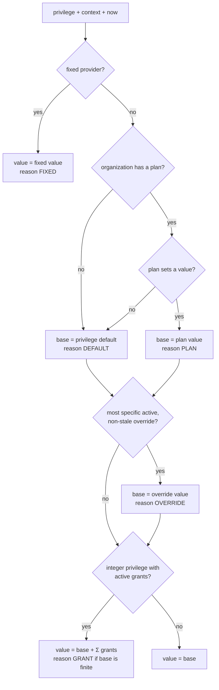

# 3. Resolution

## Overview

Resolution turns facts (an assignment, plan values, overrides, grants) into a **resolved value** for one privilege, one context, and one instant. Every provider MUST produce the same result from the same facts. That is the point of the spec. The SDKs ship this algorithm as a pure function (`resolveFromFacts`) that providers can reuse.

### 3.1. The algorithm

An instant `t` is **within** an interval `[startsAt, expiresAt)` when `startsAt ≤ t` (or `startsAt` is absent) and `t < expiresAt` (or `expiresAt` is absent).

#### Requirement 3.1.1

> If the provider is a fixed provider ([§6.4](06-providers.md#64-the-fixed-provider)), the resolved value MUST be the fixed value, with reason `FIXED`. Overrides and grants MUST NOT apply.

#### Requirement 3.1.2

> If the privilege key is not in the client's catalog, resolution MUST return reason `ERROR` with error code `PRIVILEGE_NOT_FOUND`. The value MUST be `false` for `isEnabled` and `0` for `getLimit`.

#### Requirement 3.1.3

> If the organization has no plan assignment, the base value MUST be the privilege's `default`, with reason `DEFAULT`. If the organization's plan sets no value for the privilege, the base value MUST be the privilege's `default`, with reason `DEFAULT`.

#### Requirement 3.1.4

> Otherwise, the base value MUST be the plan value, with reason `PLAN`.

#### Requirement 3.1.5

> An override **matches** a context when its `organizationId` equals the context's, its `subjectId` (if set) equals the context's `subjectId`, and its `resourceId` (if set) equals the context's `resourceId`. An override is **active** at `t` when it matches, `t` is within its interval, and its `planFamily` equals the family of the organization's current plan.

#### Requirement 3.1.6

> If one or more overrides for the privilege are active, the most specific one MUST replace the base value, with reason `OVERRIDE`. Specificity, from most to least specific: `subjectId` and `resourceId`, then `resourceId` only, then `subjectId` only, then organization only.

*Why a resource beats a subject:* a resource belongs to the organization. Its limit should not depend on which user happens to be acting on it.

#### Requirement 3.1.7

> For an `integer` privilege, every grant that is not revoked, whose interval contains `t`, and whose scope is either the organization alone or the organization plus the context's `subjectId`, MUST be added to the base value. If at least one grant applies and the base value is finite, the reason MUST be `GRANT`. If the base is `UNLIMITED`, the value MUST stay `UNLIMITED` and the reason MUST stay that of the base. Applied grants MUST be listed in either case.

Grants scoped to a *different* subject never apply. That is what makes a personal grant personal.

#### Requirement 3.1.8

> `planValue` MUST be the assigned plan's value for the privilege, before overrides and grants. It MUST be absent when the organization has no plan or the plan sets no value.

#### Requirement 3.1.9

> `staleOverrides` MUST list the ids of every override for the privilege that matches the context, has an interval containing `t`, and is inert only because its `planFamily` differs from the current plan's family (or because the organization has no plan).

#### Requirement 3.1.10

> Given the same facts, catalog, context, and `t`, resolution MUST produce the same resolution details.

#### Requirement 3.1.11

> If the provider fails (unreachable, not ready, malformed data), resolution MUST NOT throw. It MUST return the privilege's `default` as the value, with reason `ERROR`, an `errorCode`, and no applied grants.

The default is the safe, most restrictive value, so errors fail closed. An application that would rather fail open for a specific privilege MUST do so explicitly, by inspecting `reason`.

### 3.2. Feature enablement

#### Requirement 3.2.1

> `isEnabled(feature)` MUST resolve the feature's gate ([Requirement 1.1.6](01-data-model.md#requirement-116)). For a `boolean` gate it returns the resolved value. For an `integer` gate it returns `true` if and only if the resolved value is `UNLIMITED` or greater than `0`.

#### Requirement 3.2.2

> If the feature code is not in the catalog, `isEnabled` MUST return `false` with reason `ERROR` and error code `FEATURE_NOT_FOUND`.

### 3.3. Limit checks

#### Requirement 3.3.1

> A `requireWithin` check with `requested ≤ 0` MUST pass, regardless of `current` and of the limit.

**The downgrade rule.** Limits gate *new* consumption only. Being above a limit (after a downgrade, an expired grant, or a stale override) is a valid state. Existing data MUST stay readable, editable, and deletable. Decrements MUST always be allowed, so an organization can get back under its limit. A plan change MUST NOT delete, hide, or lock existing data *(the last sentence is not mechanically testable)*.

#### Requirement 3.3.2

> `current` MUST be either a non-negative integer or a **usage breakdown** `{pool, subject}` of two non-negative integers. A plain integer `n` MUST be treated as `{pool: n, subject: 0}`. `requested` MUST be an integer. Invalid arguments MUST throw `InvalidArgument`.

#### Requirement 3.3.3

> For a check in a context with value `V` and applied grants, let:
>
> - `S` = the sum of applied grants scoped to the context's `subjectId` (the **subject allowance**),
> - `P` = `V − S` (the **pool limit**: base plus organization-wide grants), or `UNLIMITED` if `V` is `UNLIMITED`,
> - `available` = `max(0, S − current.subject) + max(0, P − current.pool)`.
>
> The check MUST pass when `P` is `UNLIMITED` or `requested ≤ available`, and MUST fail otherwise.

**Shared pools and draw order.** An organization-wide quota is a single pool. Organization-scoped grants join the pool. Subject-scoped grants form a personal allowance that only that subject draws from, and the subject draws from it **first**, before the pool. `current.subject` is how much the subject has consumed *of its own allowance*. `current.pool` is how much has been drawn from the pool by everyone.

#### Requirement 3.3.4

> SDKs MUST provide a helper `poolUsage(usageBySubject, allowanceBySubject, unattributed = 0)` that returns `unattributed + Σ max(0, usageBySubject[s] − allowanceBySubject[s])`, the pool draw implied by the draw order. A subject absent from `allowanceBySubject` has an allowance of `0`.

Worked example: the pool is 1000 calls. Alice has a personal grant of +100 and used 150. Bob has no grant and used 300. The pool has been drawn `max(0, 150 − 100) + 300 = 350`. Alice can still make `max(0, 100 − 100) + (1000 − 350) = 650` calls, and so can Bob: `0 + 650`.

#### Requirement 3.3.5

> `requireWithin` MUST throw `TypeMismatch` when called on a privilege that is not of type `integer`.

#### Requirement 3.3.6

> If resolution returns reason `ERROR`, `requireWithin` MUST check against the returned value (the default) and MUST NOT pass a check that value would fail.

### 3.4. Required plan

`requiredPlan` tells a UI *which plan unlocks this*, so it can show a locked feature with an upgrade prompt instead of hiding it.

#### Requirement 3.4.1

> When a provider can enumerate plans (capability `planCatalog`), a failed `requireWithin` MUST include `requiredPlan`, and `isEnabled` details with value `false` MUST include it too, when a candidate plan exists. When no candidate exists or the provider can't enumerate plans, `requiredPlan` MUST be absent. It MUST NOT be `null` or a placeholder.

#### Requirement 3.4.2

> Candidates are plans that are `public`, have no `variantOf`, have a `rank`, belong to a family other than the organization's current plan family, and, if the current plan has a rank, have a strictly greater rank. `requiredPlan` MUST be the `id` of the lowest-ranked candidate (ties broken by `id`, ascending) whose plan value satisfies the need.

#### Requirement 3.4.3

> For a `boolean` gate, the need is satisfied by a plan value of `true`. For an `integer` gate or check, it is satisfied by `UNLIMITED` or any value ≥ `neededPlanValue`, where (with `G` = the organization-wide grants, `S` the subject allowance, and `current` as in [Requirement 3.3.3](#requirement-333)):
>
> `neededPlanValue = max(1, current.pool + requested − max(0, S − current.subject) − G)` for a check, and `1` for an integer gate.
>
> For an `enum`, the need is a target option, satisfied by any option at or after it in the declared order.

Overrides are ignored when computing `requiredPlan`, because changing plan family makes them stale.
